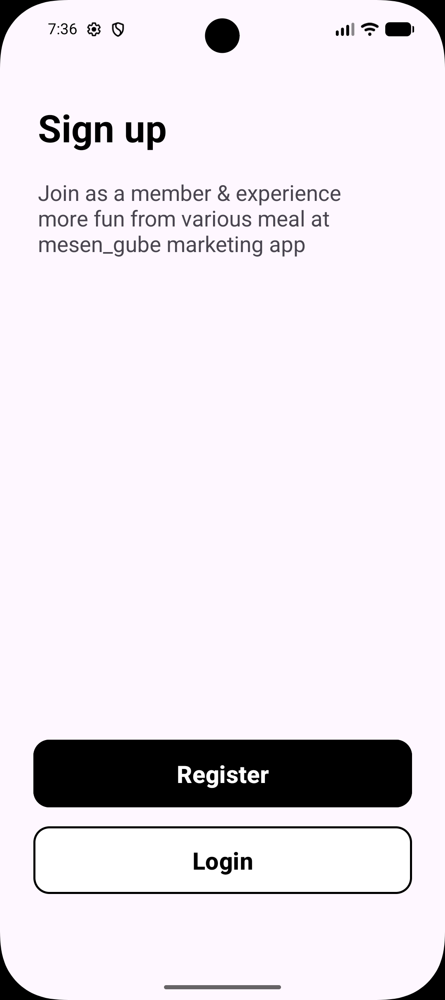
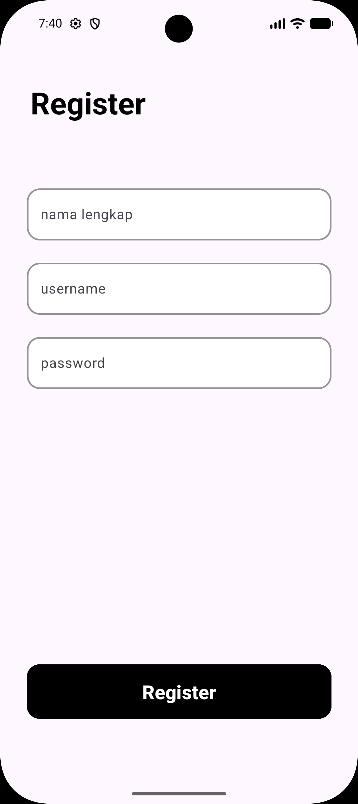
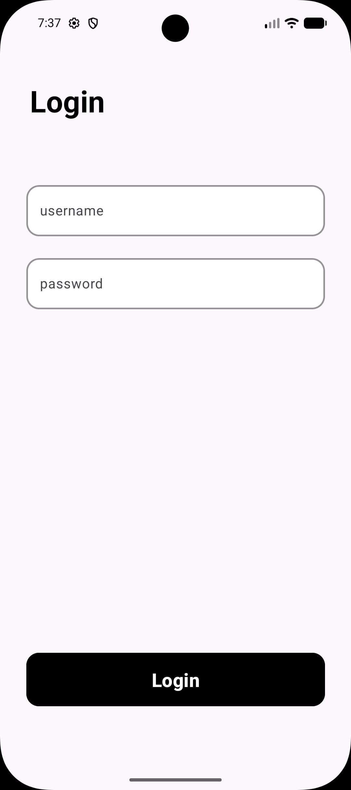
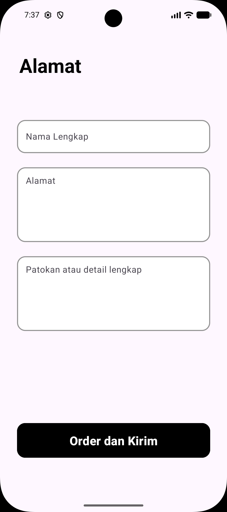
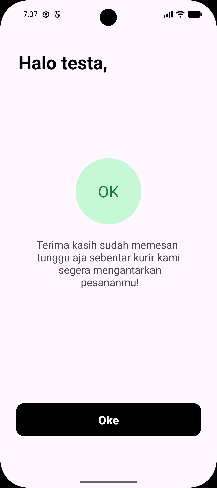
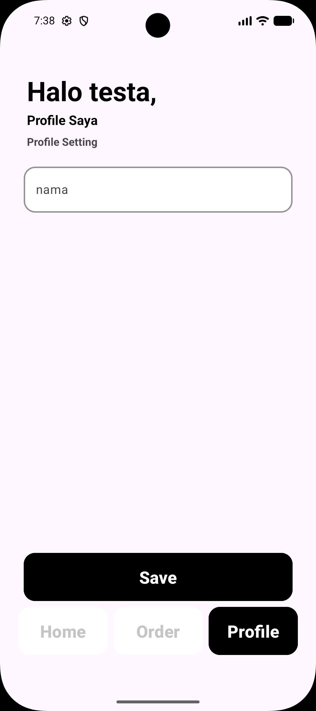

☕ KopiDanNyemil
KopiDanNyemil adalah project aplikasi Android yang dikembangkan menggunakan Android Studio. Aplikasi ini dibuat untuk menampilkan daftar produk kopi dan camilan dengan tampilan yang sederhana dan menarik.

📱 Tentang Project
KopiDanNyemil merupakan aplikasi berbasis Android yang berfokus pada penyajian informasi produk, seperti nama produk, deskripsi, harga, dan gambar produk.

Project ini juga menjadi sarana pembelajaran dalam mengembangkan aplikasi Android menggunakan Kotlin dan komponen antarmuka Android.

✨ Fitur
Register User dengan mengisi nama, username dan password.
Login User.
Menampilkan daftar produk kopi dan camilan.
Menampilkan nama produk.
Menampilkan deskripsi produk.
Menampilkan harga produk.
Menampilkan gambar yang berbeda untuk setiap produk.
Menggunakan RecyclerView untuk menampilkan daftar produk.
Mengubah nama profil.

🛠️ Teknologi yang Digunakan
Bahasa Pemrograman: Kotlin
IDE: Android Studio
UI Layout: XML
List Component: RecyclerView
Build System: Gradle (Kotlin DSL)
Platform: Android

📂 Struktur Project

text
KopiDanNyemil/
├── app/
│   └── src/
│       └── main/
│           ├── java/
│           │   └── lat/pam/kopidannyemil/
│           ├── res/
│           │   ├── drawable/
│           │   ├── layout/
│           │   └── values/
│           └── AndroidManifest.xml
├── gradle/
├── build.gradle.kts
├── settings.gradle.kts
└── README.md

🚀 Cara Menjalankan Project
1. Clone repository ini:
bash
git clone https://github.com/gitthubuserr/KopiDanNyemil.git

2. Buka Android Studio.
3. Pilih Open dan cari folder KopiDanNyemil.
4. Tunggu proses Gradle Sync selesai.
5. Jalankan aplikasi menggunakan emulator atau perangkat Android.

📸 Screenshots
Berikut adalah tampilan aplikasi KopiDanNyemil:

📱 Screenshots Aplikasi
Halaman Utama

Halaman Sign Up

Halaman Register

Halaman Login

Halaman Home

Halaman Produk

Halaman Order

Halaman Confirmation

Halaman Profile

🎯 Tujuan Pengembangan
Project ini dibuat sebagai sarana pembelajaran pengembangan aplikasi Android, khususnya dalam penggunaan Kotlin, XML Layout, RecyclerView, dan pengelolaan data produk.

👨‍💻 Developer
GitHub: @gitthubuserr
